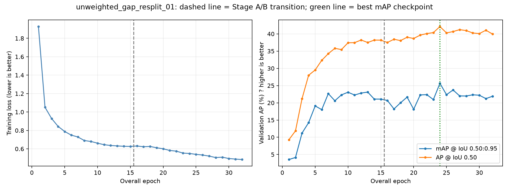

# Training results

Run: `unweighted_gap_resplit_01`

Completed epochs: 32 (15 Stage A, 17 Stage B).
Best checkpoint: Stage B, epoch 9; selection metadata matches epoch records: True.

| Measure | Best checkpoint | Latest epoch |
|---|---:|---:|
| Validation mAP@0.50:0.95 | 25.65% | 21.90% |
| Validation AP@0.50 | 42.11% | 39.96% |
| Training loss | 0.5497 | 0.4842 |

AP values are precision-recall summary metrics, not the percentage of images classified correctly.

## Per-class results at the best checkpoint

| Class | AP@0.50:0.95 | AP@0.50 | Validation GT boxes |
|---|---:|---:|---:|
| bridge | 31.02% | 52.75% | 4 |
| gap | 0.40% | 1.07% | 4 |
| line_collapse | 22.61% | 39.38% | 3 |
| multi_bridge | 48.58% | 75.25% | 2 |

Support counts boxes, not images. The small validation set limits precision of these estimates.

## Reading the curves

- Training loss: lower means a better fit to training targets; it does not guarantee better held-out detections.
- Validation mAP: higher is better. This is the checkpoint-selection metric.
- AP@0.50 uses a less strict box-overlap requirement than mAP averaged over 0.50 through 0.95.
- Falling training loss alongside falling validation AP can indicate overfitting or unstable generalization; it does not by itself establish the cause.

## Every completed epoch

| Stage | Epoch | Training loss | Validation mAP | Validation AP50 |
|---|---:|---:|---:|---:|
| A | 1 | 1.9271 | 3.55% | 9.30% |
| A | 2 | 1.0515 | 4.14% | 11.85% |
| A | 3 | 0.9296 | 11.22% | 21.21% |
| A | 4 | 0.8433 | 14.24% | 27.99% |
| A | 5 | 0.7886 | 19.09% | 29.53% |
| A | 6 | 0.7490 | 18.02% | 32.33% |
| A | 7 | 0.7290 | 22.66% | 34.26% |
| A | 8 | 0.6901 | 20.60% | 35.81% |
| A | 9 | 0.6800 | 22.30% | 35.44% |
| A | 10 | 0.6617 | 23.07% | 37.41% |
| A | 11 | 0.6451 | 22.27% | 37.45% |
| A | 12 | 0.6365 | 22.82% | 38.22% |
| A | 13 | 0.6318 | 23.11% | 37.49% |
| A | 14 | 0.6278 | 21.08% | 38.20% |
| A | 15 | 0.6267 | 21.08% | 38.18% |
| B | 1 | 0.6310 | 20.68% | 37.50% |
| B | 2 | 0.6230 | 18.22% | 38.44% |
| B | 3 | 0.6260 | 20.01% | 38.04% |
| B | 4 | 0.6118 | 21.65% | 39.03% |
| B | 5 | 0.6006 | 18.13% | 38.67% |
| B | 6 | 0.5824 | 22.29% | 39.64% |
| B | 7 | 0.5750 | 22.37% | 40.09% |
| B | 8 | 0.5542 | 20.94% | 40.37% |
| B | 9 | 0.5497 | 25.65% | 42.11% |
| B | 10 | 0.5402 | 22.35% | 40.29% |
| B | 11 | 0.5329 | 23.73% | 40.67% |
| B | 12 | 0.5211 | 22.00% | 41.22% |
| B | 13 | 0.5056 | 21.98% | 40.96% |
| B | 14 | 0.5096 | 22.32% | 40.26% |
| B | 15 | 0.4950 | 22.21% | 40.09% |
| B | 16 | 0.4889 | 21.22% | 41.06% |
| B | 17 | 0.4842 | 21.90% | 39.96% |

Threshold-dependent precision/recall/F1, image classification and clean-image false-alarm metrics require the separate validation evaluation command.
No test data or inference was used to generate this report.