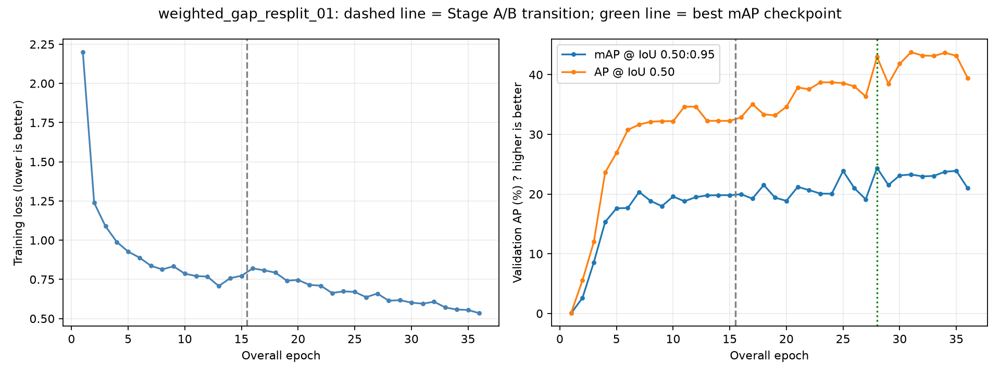

# Training results

Run: `weighted_gap_resplit_01`

Completed epochs: 36 (15 Stage A, 21 Stage B).
Best checkpoint: Stage B, epoch 13; selection metadata matches epoch records: True.

| Measure | Best checkpoint | Latest epoch |
|---|---:|---:|
| Validation mAP@0.50:0.95 | 24.37% | 20.98% |
| Validation AP@0.50 | 42.96% | 39.41% |
| Training loss | 0.6140 | 0.5343 |

AP values are precision-recall summary metrics, not the percentage of images classified correctly.

## Per-class results at the best checkpoint

| Class | AP@0.50:0.95 | AP@0.50 | Validation GT boxes |
|---|---:|---:|---:|
| bridge | 24.52% | 49.86% | 4 |
| gap | 0.13% | 0.21% | 4 |
| line_collapse | 17.29% | 38.28% | 3 |
| multi_bridge | 55.52% | 83.50% | 2 |

Support counts boxes, not images. The small validation set limits precision of these estimates.

## Reading the curves

- Training loss: lower means a better fit to training targets; it does not guarantee better held-out detections.
- Validation mAP: higher is better. This is the checkpoint-selection metric.
- AP@0.50 uses a less strict box-overlap requirement than mAP averaged over 0.50 through 0.95.
- Falling training loss alongside falling validation AP can indicate overfitting or unstable generalization; it does not by itself establish the cause.

## Every completed epoch

| Stage | Epoch | Training loss | Validation mAP | Validation AP50 |
|---|---:|---:|---:|---:|
| A | 1 | 2.1991 | 0.05% | 0.12% |
| A | 2 | 1.2385 | 2.62% | 5.56% |
| A | 3 | 1.0889 | 8.58% | 12.00% |
| A | 4 | 0.9886 | 15.33% | 23.62% |
| A | 5 | 0.9273 | 17.61% | 26.91% |
| A | 6 | 0.8890 | 17.67% | 30.75% |
| A | 7 | 0.8370 | 20.36% | 31.64% |
| A | 8 | 0.8136 | 18.87% | 32.11% |
| A | 9 | 0.8334 | 17.98% | 32.22% |
| A | 10 | 0.7864 | 19.57% | 32.21% |
| A | 11 | 0.7714 | 18.80% | 34.64% |
| A | 12 | 0.7678 | 19.49% | 34.64% |
| A | 13 | 0.7073 | 19.77% | 32.26% |
| A | 14 | 0.7579 | 19.81% | 32.27% |
| A | 15 | 0.7730 | 19.81% | 32.26% |
| B | 1 | 0.8200 | 19.97% | 32.85% |
| B | 2 | 0.8081 | 19.24% | 35.06% |
| B | 3 | 0.7929 | 21.52% | 33.34% |
| B | 4 | 0.7420 | 19.40% | 33.19% |
| B | 5 | 0.7464 | 18.86% | 34.62% |
| B | 6 | 0.7150 | 21.21% | 37.86% |
| B | 7 | 0.7098 | 20.66% | 37.55% |
| B | 8 | 0.6631 | 20.08% | 38.71% |
| B | 9 | 0.6736 | 20.05% | 38.71% |
| B | 10 | 0.6702 | 23.87% | 38.58% |
| B | 11 | 0.6364 | 20.98% | 38.03% |
| B | 12 | 0.6596 | 19.12% | 36.34% |
| B | 13 | 0.6140 | 24.37% | 42.96% |
| B | 14 | 0.6176 | 21.51% | 38.48% |
| B | 15 | 0.6016 | 23.12% | 41.82% |
| B | 16 | 0.5950 | 23.28% | 43.76% |
| B | 17 | 0.6075 | 22.96% | 43.21% |
| B | 18 | 0.5707 | 23.04% | 43.14% |
| B | 19 | 0.5576 | 23.74% | 43.65% |
| B | 20 | 0.5548 | 23.88% | 43.17% |
| B | 21 | 0.5343 | 20.98% | 39.41% |

Threshold-dependent precision/recall/F1, image classification and clean-image false-alarm metrics require the separate validation evaluation command.
No test data or inference was used to generate this report.